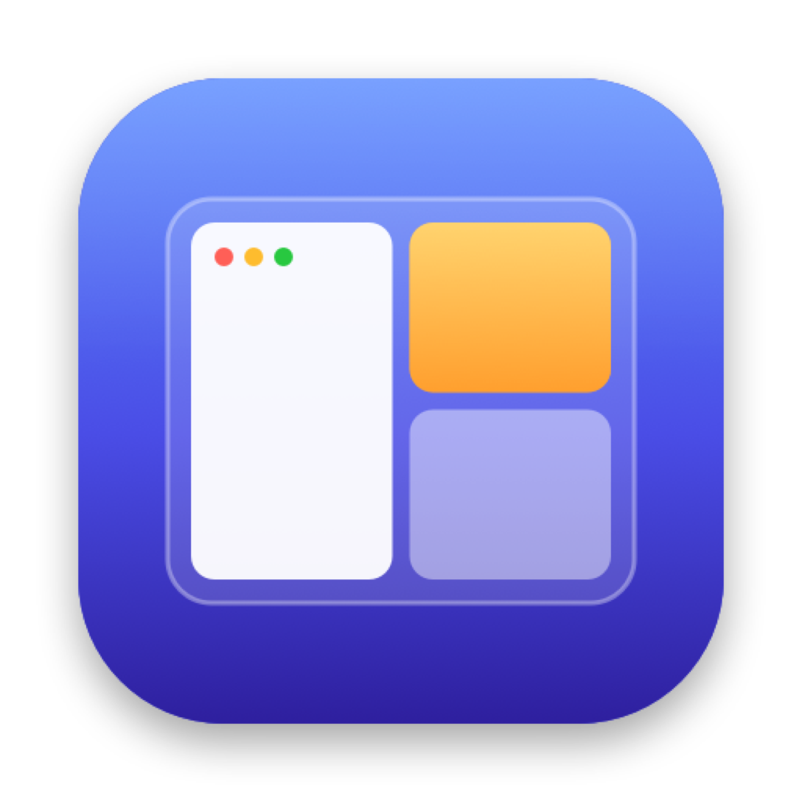
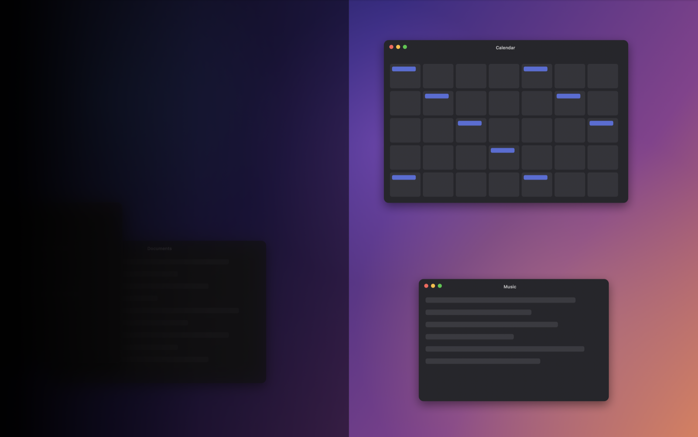
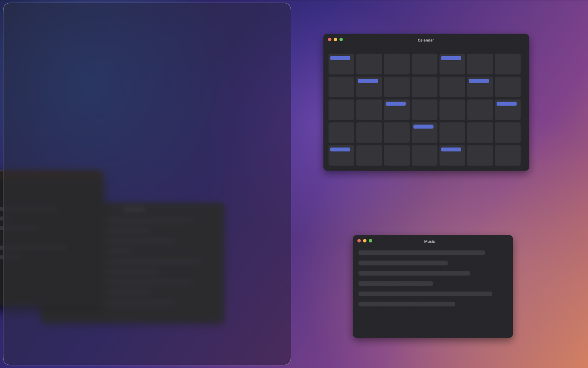
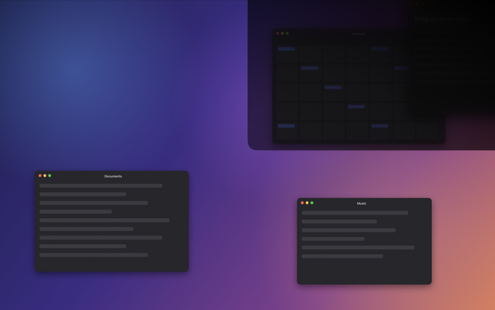
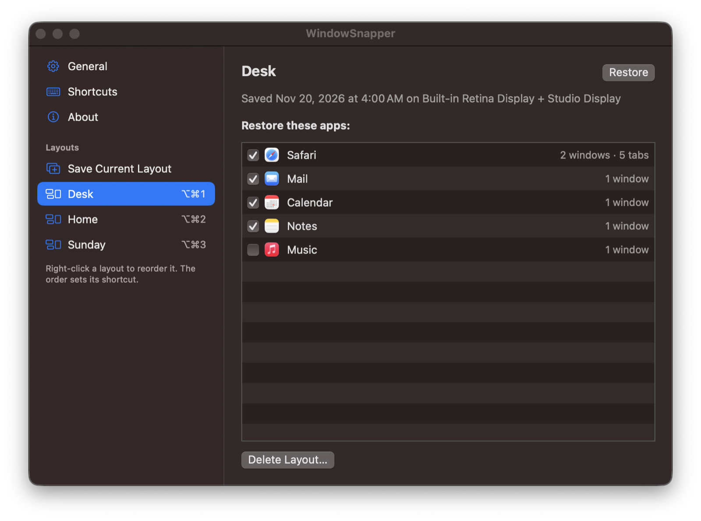
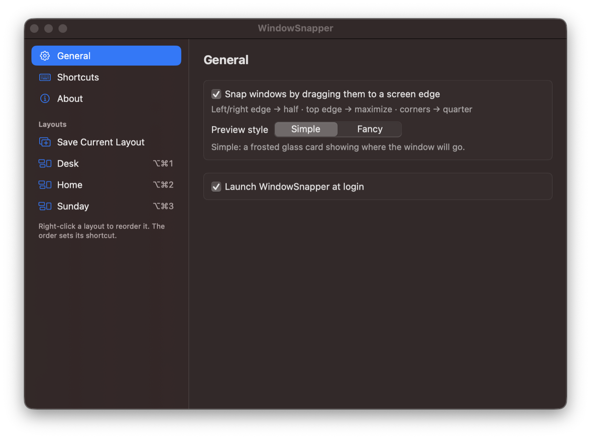
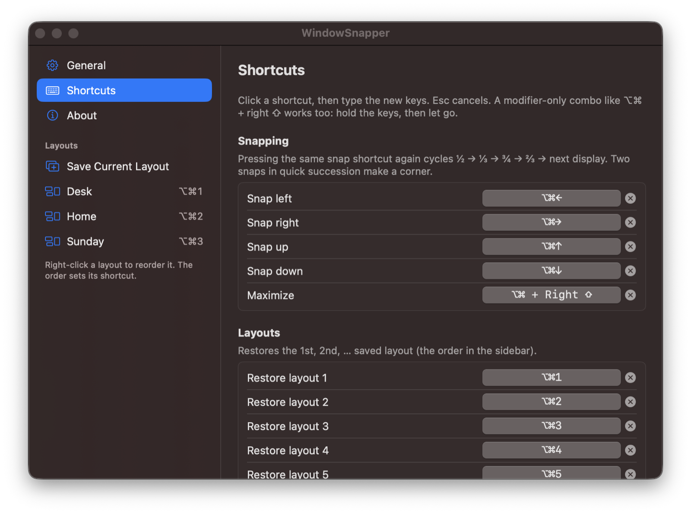
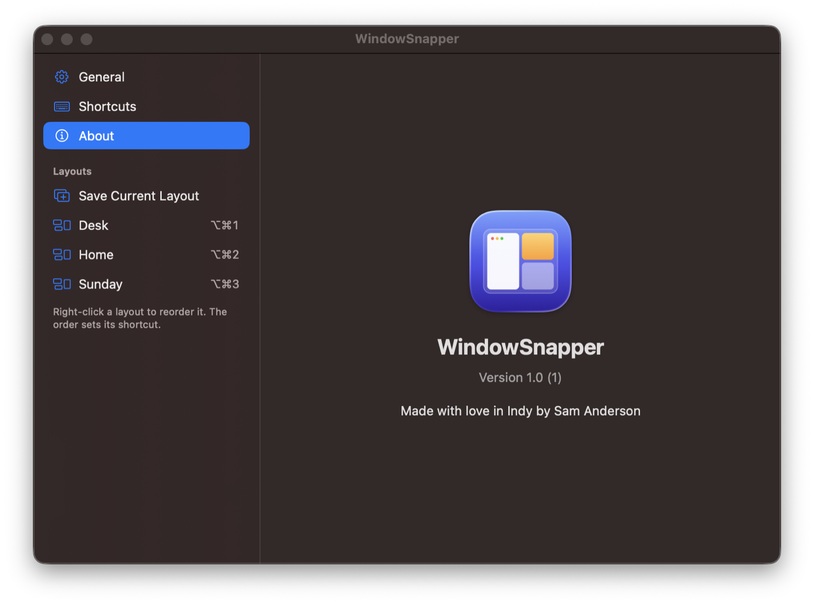

<p align="center">
  
</p>

<h1 align="center">WindowSnapper</h1>

<p align="center">
  A tiny, fast window manager for macOS that lives in your menu bar.<br>
  Snap windows with the keyboard or by dragging, and bring back your whole desk setup with one shortcut.
</p>

<p align="center">
  
  
  
  
</p>

<p align="center">
  
</p>

---

## Contents

- [Features](#features)
- [Install](#install)
- [Keyboard snapping](#keyboard-snapping)
- [Drag to snap](#drag-to-snap)
- [Layouts](#layouts)
- [Settings](#settings)
- [Help & FAQ](#help--faq)
- [Building from source](#building-from-source)

## Features

- **Keyboard snapping that cycles.** Press ⌥⌘ ← again and again: ½ → ⅓ → ¾ → ⅔ → the next display.
- **Corners.** Tap two arrows quickly (like ↑ then →) for a quarter of the screen.
- **Fill the gap.** Press ⌥⌘ / and the window grows into the empty space around it, right up to its neighbours.
- **Drag to snap.** Drag a window to an edge or corner. A smooth, springy preview shows where it'll land.
- **Layouts.** Save where all your windows are (Desk, Home, Sunday…) and restore them with ⌥⌘1, ⌥⌘2…
- **Browser-aware.** Chrome, Safari, Edge, Brave and Vivaldi windows are matched by their tabs, and missing windows are reopened with those tabs.
- **Customizable shortcuts.** Change any shortcut, including modifier-only combos like ⌥⌘ + right ⇧.
- **Light.** Native Swift, about 1 MB, no Dock icon, no background services.

## Install

### Download

1. Download **[WindowSnapper.zip](https://github.com/samandrsn/WindowSnapper/releases/latest/download/WindowSnapper.zip)** from the [latest release](https://github.com/samandrsn/WindowSnapper/releases/latest).
2. Unzip it and drag **WindowSnapper.app** into your **Applications** folder.
3. Open it. macOS will say it can't verify the app, because WindowSnapper isn't notarized by Apple. Click **Done**, then go to **System Settings → Privacy & Security**, scroll down, and click **Open Anyway** next to WindowSnapper. You only need to do this once.
4. Allow **Accessibility** access when asked (**System Settings → Privacy & Security → Accessibility** → turn on WindowSnapper). That's what lets it move other apps' windows.
5. Turn on **Launch at login** in WindowSnapper's settings.

The app is a universal build for Apple Silicon and Intel Macs running macOS 13 or later.

> **Updating?** After replacing the app, macOS may need Accessibility switched off and on again for the new copy.

### Build from source

```bash
git clone https://github.com/samandrsn/WindowSnapper.git
cd WindowSnapper
./build.sh --install
```

This builds the app, copies it to `/Applications` and opens it. You'll need the Xcode command line tools (`xcode-select --install`).

## Keyboard snapping

Keep pressing the same shortcut to cycle through sizes.

| Shortcut | 1st press | 2nd | 3rd | 4th | 5th |
|---|---|---|---|---|---|
| ⌥⌘ ← | Left ½ | ⅓ | ¾ | ⅔ | Display to the left |
| ⌥⌘ → | Right ½ | ⅓ | ¾ | ⅔ | Display to the right |
| ⌥⌘ ↑ | Top ½ | ⅓ | ¾ | ⅔ | Display above |
| ⌥⌘ ↓ | Bottom ½ | ⅓ | ¾ | ⅔ | Display below |
| ⌥⌘ + right ⇧ | Maximize to the whole display (not macOS full screen) | | | | |
| ⌥⌘ / | Fill the gap: grow into the empty space around the window | | | | |

**Fill the gap (⌥⌘ /):** grows the window into the empty space around it. Each edge moves out until it meets another window or the edge of the screen. Handy for the empty middle of an ultrawide, or the space between a window across the top and one across the bottom.

**Corners:** press two arrows at right angles within a quarter of a second. For example, ↑ then → puts the window in the top-right quarter. From there, → keeps cycling the width and ↑ keeps cycling the height, and the window stays in the corner. Press an opposite arrow to leave the corner.

A few details:

- The cycle only continues while you keep snapping the same window. If you move it yourself, the next press starts again at ½.
- With no display in that direction, the 5th press wraps around to the far side. With one display it goes back to ½.
- Apps with a minimum size, like Outlook, stay tucked against the edge they were snapped to.

## Drag to snap

Drag a window by its title bar to the edge of the screen:

| Drag to | Window goes to |
|---|---|
| Left or right edge | That half |
| Top edge | Maximized |
| Any corner | That quarter |

A preview flows out of the cursor like a droplet and springs into place. Slide to another zone and it glides over with its momentum. Let go and the window snaps in. There are two preview styles:

<table>
  <tr>
    <td width="50%"></td>
    <td width="50%"></td>
  </tr>
  <tr>
    <td><b>Simple</b> (default): a frosted glass card showing where the window will go.</td>
    <td><b>Fancy</b>: darkens and blurs toward the screen edge, fading to black.</td>
  </tr>
</table>

After a drag, the keyboard carries on from there. Drag to the left edge, then press ⌥⌘ ← for ⅓.

> **Tip:** macOS has its own drag-to-tile feature. If both react, turn off **“Drag windows to screen edges to tile”** in System Settings → Desktop & Dock. WindowSnapper warns you in settings if it's on.

## Layouts

Moving between a desk with monitors and a laptop on the couch? Save each setup once and restore it in a second.

<p align="center">
  
</p>

**To save:** open the menu bar icon → **Save Current Layout…**. Name it (Desk, Home…) and tick the apps to include. Only apps you can actually see are ticked to start, and apps you untick stay unticked next time. Saving with an existing name updates that layout.

**To restore:** press **⌥⌘1** for your first layout, **⌥⌘2** for the second, and so on. You can also pick a layout from the menu bar icon. Restoring:

- opens apps that aren't running
- puts every window back where it was, matching each window by its title, or by its tabs for browsers
- reopens browser windows that were closed, with their tabs
- places windows on the same display they were on. If that display isn't connected, they go to the main display, scaled to fit.

In a layout's page you can untick apps so Restore skips them. Right-click a layout in the sidebar to move it up or down, which also changes its number.

The first time you save a browser's windows, macOS asks whether WindowSnapper may control that browser. That's how it reads tabs.

## Settings

Open the menu bar icon → **Settings…** (⌘,).

<table>
  <tr>
    <td width="50%"></td>
    <td width="50%"></td>
  </tr>
  <tr>
    <td><b>General</b>: drag to snap, preview style, launch at login.</td>
    <td><b>Shortcuts</b>: click any shortcut and type new keys. Esc cancels. <b>Restore Defaults</b> puts everything back.</td>
  </tr>
</table>

## Help & FAQ

<details>
<summary><b>The shortcuts don't do anything.</b></summary>

WindowSnapper needs Accessibility access. Open **System Settings → Privacy & Security → Accessibility** and make sure WindowSnapper is on. If you rebuilt the app, toggle it off and on again. When access is missing, the menu bar menu shows a <i>Grant Accessibility Access…</i> item.
</details>

<details>
<summary><b>⌥⌘ ← / → also switches tabs in my browser.</b></summary>

Chrome and some editors use the same keys. WindowSnapper's shortcut wins while it's running. If you'd rather keep the browser shortcut, change the snapping shortcuts under **Settings → Shortcuts**.
</details>

<details>
<summary><b>A restored window isn't quite the right size.</b></summary>

Some apps have a minimum size or only resize in steps (Terminal resizes by whole characters). WindowSnapper gets as close as the app allows and keeps the window against the right screen edges. If an app moves its own window back right after launching, WindowSnapper checks again a couple of seconds later and fixes it.
</details>

<details>
<summary><b>Some windows weren't saved.</b></summary>

Layouts save windows on the current desktop (Space) only. Minimized and hidden windows are skipped.
</details>

<details>
<summary><b>Where is my data?</b></summary>

Layouts are stored in `~/Library/Application Support/WindowSnapper/layouts.json`, and settings in the app's preferences. Nothing leaves your Mac.
</details>

<details>
<summary><b>How do I restore a layout from a script?</b></summary>

```bash
open -a WindowSnapper --args --restore "Desk"
```

This works when WindowSnapper isn't already running.
</details>

## Building from source

```bash
swift test                # geometry, cycling, drag zones and window-matching tests
./build.sh                # builds build/WindowSnapper.app
./build.sh --release      # universal, ad-hoc signed build zipped as build/WindowSnapper.zip
```

`build.sh` signs with your Apple Development certificate if you have one. macOS ties Accessibility access to the signature, so with a stable certificate you only grant it once. Otherwise it signs ad hoc.

The app icon is drawn in code: `swift scripts/make_icon.swift <out.iconset>`, then `iconutil -c icns`.

| Folder | What's in it |
|---|---|
| `Sources/SnapCore` | Pure logic: snap geometry and cycling, drag zones, layout models, window matching |
| `Sources/WindowSnapper` | The menu bar app: hotkeys, Accessibility, drag preview, layouts, settings |
| `Tests/SnapCoreTests` | Unit tests |

---

<p align="center">
  <br>
  Made with love in Indy by Sam Anderson
</p>
